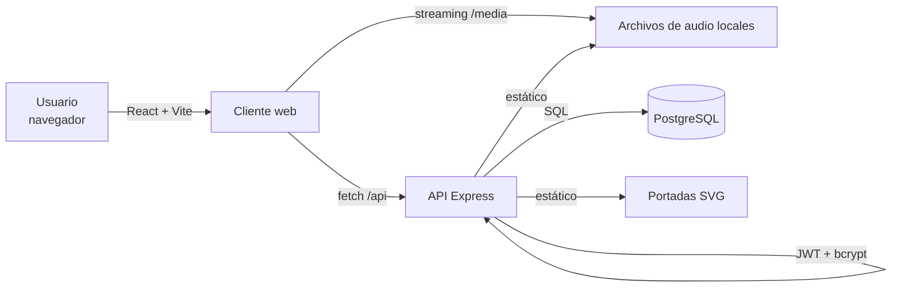
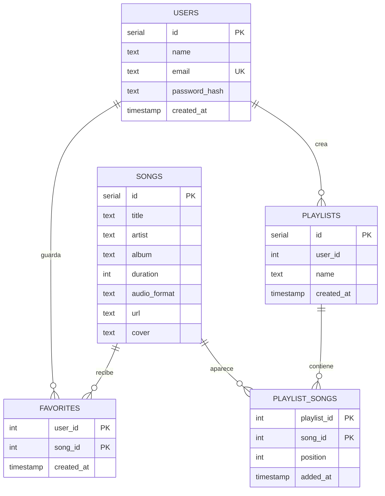
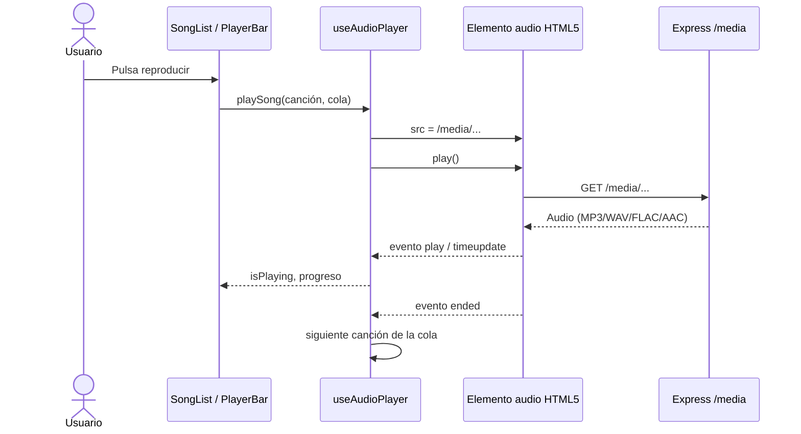
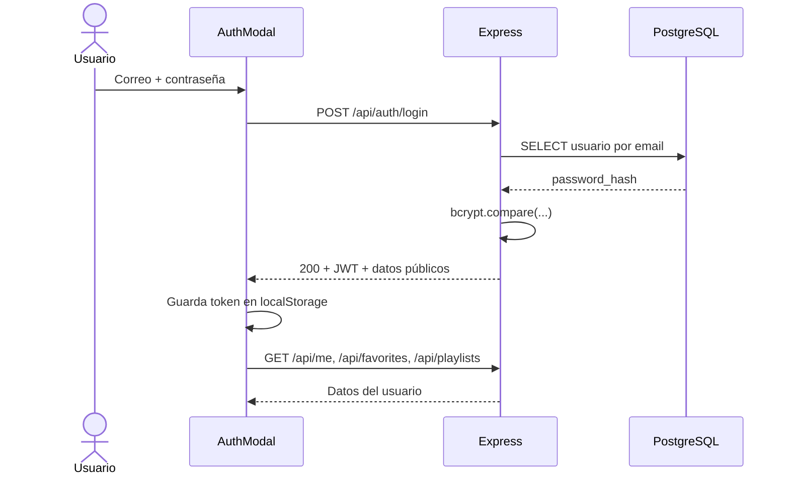

# Arquitectura — Tarara Music

## Visión general



- **Frontend:** React 18 + Vite. Estado de sesión en `localStorage`; el reproductor usa
  un único elemento `<audio>` controlado por `useAudioPlayer`.
- **Backend:** Express con rutas REST, JWT y bcrypt. Sirve también las portadas y los
  archivos de audio.
- **Base de datos:** PostgreSQL en producción; pg-mem con el mismo SQL en pruebas y en
  el modo demo sin base de datos.
- **Despliegue:** `npm run build` genera `client/dist`; `npm start` sirve la API y el
  frontend desde Express.

## Modelo de datos



## Flujo de reproducción



## Flujo de autenticación



## Estructura de carpetas

```text
client/src/
  App.jsx                  Orquestación de vistas y estado global
  components/
    Header.jsx             Buscador y acceso
    Sidebar.jsx            Navegación y listas
    SongList.jsx           Filas de canciones, favoritos y añadir a lista
    PlayerBar.jsx          Controles de reproducción y volumen
    AuthModal.jsx          Registro / inicio de sesión
    PlaylistsView.jsx      Creación y tarjetas de listas
    ProfilePanel.jsx       Datos y seguridad de la cuenta
  hooks/useAudioPlayer.js  Lógica del elemento <audio>
  lib/api.js               Cliente HTTP y token
  utils/format.js          Formatos de tiempo, iniciales, filtros

server/src/
  app.js                   Configuración de Express
  index.js                 Arranque y apagado ordenado
  config.js                Variables de entorno
  seed.js                  Catálogo de 10 canciones
  db/schema.js             DDL compartido
  db/postgres.js           Pool de PostgreSQL
  db/memory.js             pg-mem para demo/pruebas
  routes/auth.js           Registro e inicio de sesión
  routes/songs.js          Biblioteca, búsqueda y formatos
  routes/me.js             Perfil, favoritos y listas
  middleware/auth.js       Verificación JWT
```

## Decisiones de diseño

1. **Escuchar sin cuenta:** la biblioteca y la reproducción son públicas (RF-01 y RF-02
   son *Should*), mientras que favoritos, listas y perfil requieren JWT.
2. **Un solo elemento `<audio>`:** evita solapamientos y facilita la reproducción
   continua, el progreso y el volumen.
3. **SQL portable:** las consultas usan `LOWER(...) LIKE` y `LEFT JOIN` en lugar de
   `ILIKE`/subconsultas correlacionadas para funcionar igual en PostgreSQL y pg-mem.
4. **Contraseñas:** bcrypt con 10 rondas por defecto; el hash nunca sale de la API.
5. **Catálogo local:** 10 pistas generadas para la demo, con 4 formatos y portadas SVG
   servidas por el propio backend.
