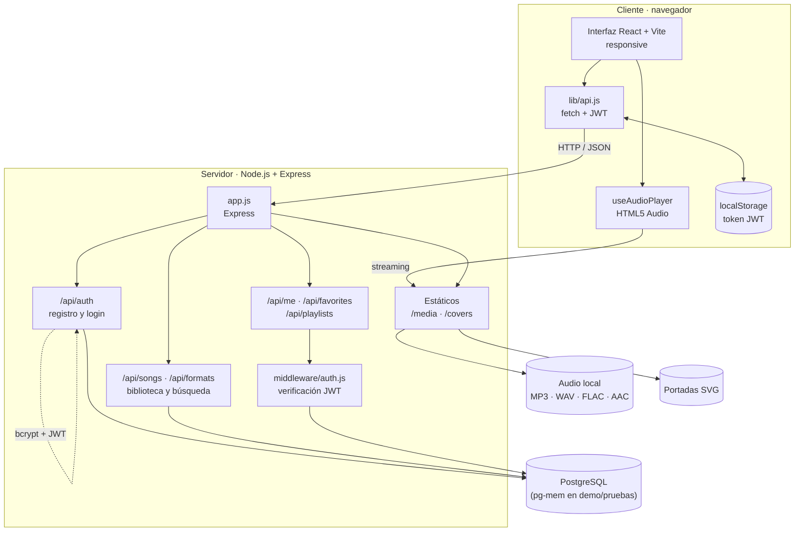
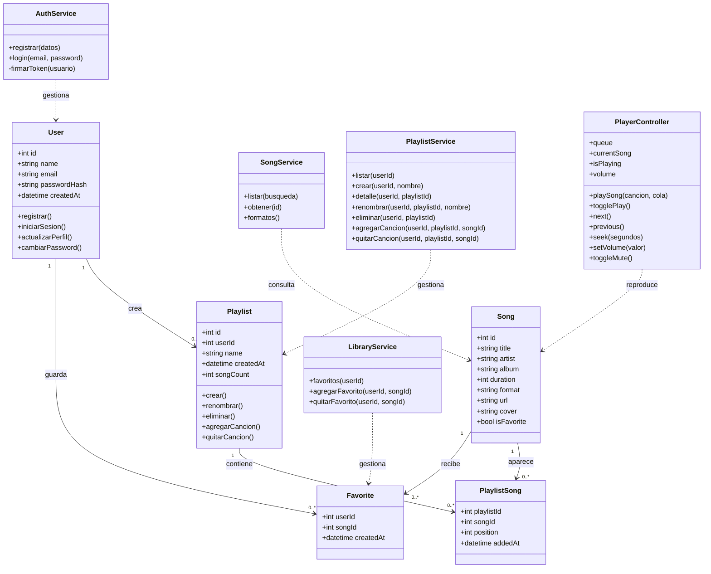
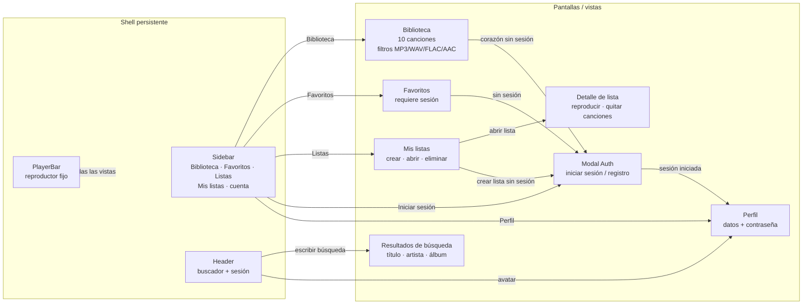
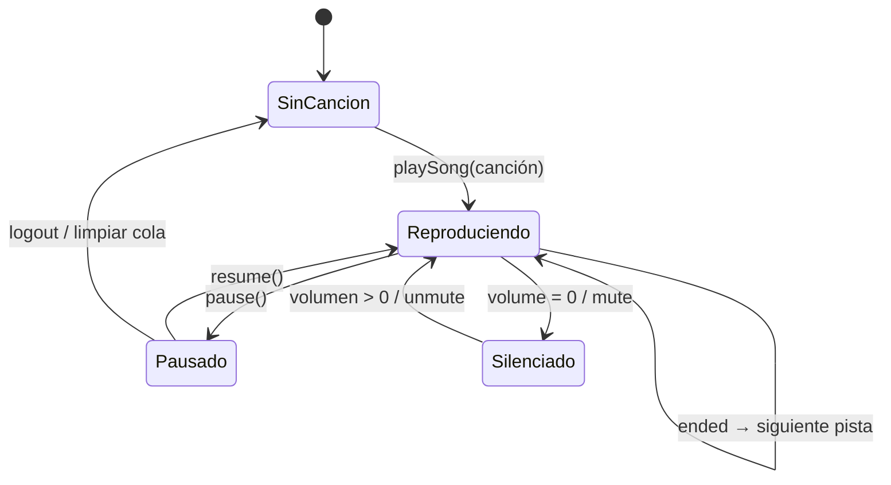

# Diagramas Mermaid — Tarara Music

Puedes pegar cada bloque en <https://mermaid.live> o en cualquier visor compatible con Mermaid
(GitHub, GitLab, Notion, VS Code + extensión Markdown Preview Mermaid).

## Archivos generados

En `docs/diagramas/` están los fuentes y las imágenes listas para el informe:

| Diagrama | Fuente | SVG | PNG |
| --- | --- | --- | --- |
| Arquitectura | `arquitectura.mmd` | `arquitectura.svg` | `arquitectura.png` |
| Clases | `clases.mmd` | `clases.svg` | `clases.png` |
| Interfaces | `interfaces.mmd` | `interfaces.svg` | `interfaces.png` |
| Estados del reproductor | `estados.mmd` | `estados.svg` | `estados.png` |

Los SVG son vectoriales (ideales para Word/PDF); los PNG tienen fondo transparente.

---

## 1. Diagrama de arquitectura

---

## 2. Diagrama de clases

---

## 3. Diagrama de interfaces (pantallas y navegación)

### Flujo de estados del reproductor

